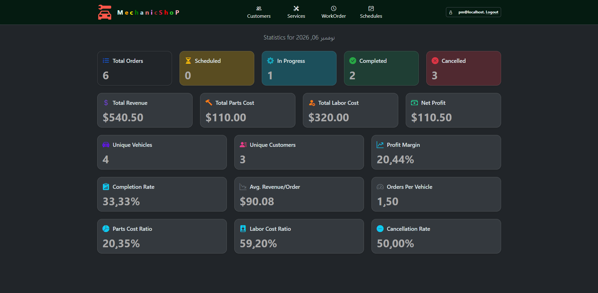
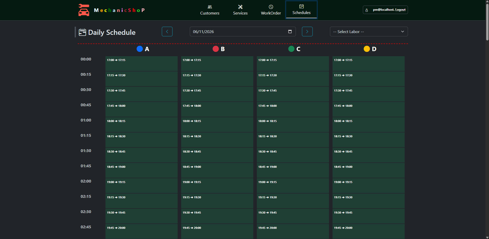
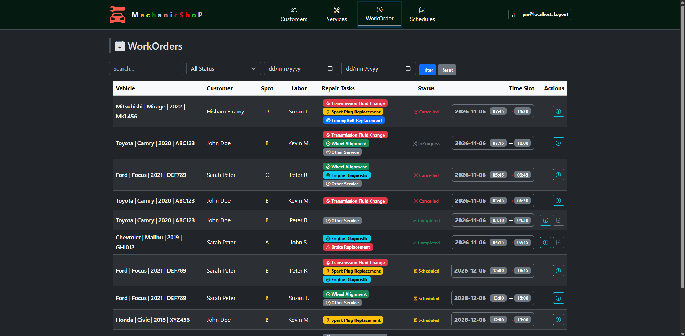
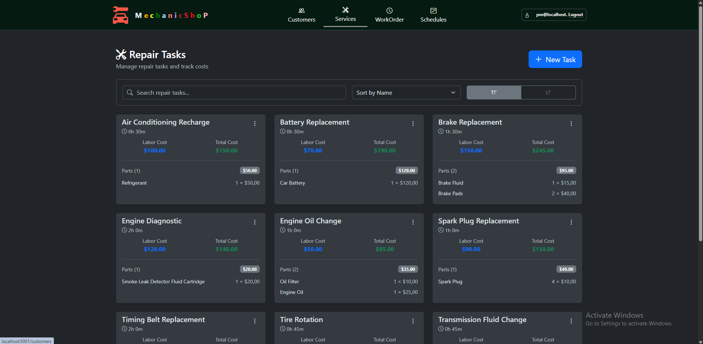
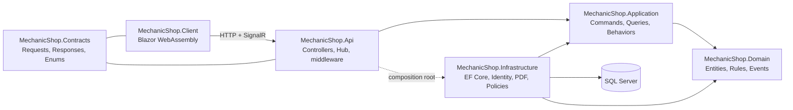
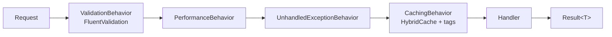

# MechanicShop - Hisham Elramy

[](https://github.com/hisham-elramy/MechanicShop/actions/workflows/build-and-test.yml)


A full-stack workshop management system for an auto repair shop. It schedules work orders across service bays, prevents double-booking of bays, mechanics and vehicles, enforces operating hours, tracks each job through its lifecycle, and issues invoices as PDFs.

Built with **ASP.NET Core**, **Blazor WebAssembly**, **EF Core / SQL Server**, and **MediatR (CQRS)**, with Docker Compose for local setup and GitHub Actions for CI.

<!-- Replace with a screenshot or GIF of the Daily Schedule page -->


---

## Table of contents

- [MechanicShop - Hisham Elramy](#mechanicshop---hisham-elramy)
  - [Table of contents](#table-of-contents)
  - [Features](#features)
  - [Screenshots](#screenshots)
  - [Tech stack](#tech-stack)
  - [Architecture](#architecture)
    - [Request pipeline](#request-pipeline)
  - [Getting started](#getting-started)
    - [Option 1: Docker Compose (recommended)](#option-1-docker-compose-recommended)
    - [Option 2: Run locally with the .NET SDK](#option-2-run-locally-with-the-net-sdk)
  - [Demo accounts](#demo-accounts)
  - [Running the tests](#running-the-tests)
  - [Continuous integration](#continuous-integration)
  - [Configuration](#configuration)
  - [Project structure](#project-structure)
  - [Design decisions](#design-decisions)
  - [Known limitations and roadmap](#known-limitations-and-roadmap)
  - [License](#license)

---

## Features

**Scheduling**
- Daily schedule grid with four service bays (A to D) on a 15-minute grid.
- A work order's duration and price are derived from the selected repair tasks.
- Conflict rules enforced on the server: a **bay**, a **mechanic**, and a **vehicle** can each be booked only once for any overlapping time range. Bookings outside operating hours, or shorter than the configured minimum, are rejected.
- Work orders can be relocated to another bay or time, reassigned to another mechanic, and have their repair tasks changed while they are still `Scheduled`.

**Work order lifecycle**
- State machine: `Scheduled → InProgress → Completed`, and `Cancelled` from any state except `Completed`.
- Only `Scheduled` work orders are editable.
- A background service automatically cancels `Scheduled` work orders that have not started within a configurable threshold (default 15 minutes, checked every 3 minutes).
- Real-time updates to connected clients through a SignalR hub.

**Customers, vehicles and services**
- Customers with multiple vehicles, with search and sorting.
- Repair tasks with a duration, labor cost, and a list of parts. Totals are calculated automatically.

**Billing**
- Issue an invoice for a completed work order, settle it, and download it as a PDF (QuestPDF).
- Settled invoices are locked, and a work order can only be invoiced once.

**Dashboard**
- Order counts by state, revenue, parts and labor cost, net profit, margin, completion and cancellation rates.

**Security**
- ASP.NET Core Identity with JWT bearer authentication and refresh tokens.
- Two roles, **Manager** and **Labor**. Managers manage everything; labor users are scoped to the work orders assigned to them.
- Login returns the same error for an unknown email and a wrong password, so the endpoint cannot be used to discover registered emails.

**Operations**
- Structured logging with Serilog, distributed tracing with OpenTelemetry, and a Seq container for viewing them.
- Versioned REST API (`/api/v1.0/...`) with OpenAPI, Swagger UI and Scalar in Development.
- Consistent `ProblemDetails` error responses and a global exception handler.

---

## Screenshots

<!-- Add the files under docs/images/ -->

| Dashboard | Daily schedule |
|---|---|
|  |  |

| Work orders | Services |
|---|---|
|  |  |

---

## Tech stack

| Layer | Technology |
|---|---|
| Frontend | Blazor WebAssembly (served by the API host), SignalR client, Blazored.LocalStorage |
| API | ASP.NET Core (.NET 10), controllers, API versioning, OpenAPI, Scalar, Swagger UI, output caching |
| Application | MediatR, FluentValidation, HybridCache, Result pattern |
| Domain | Plain C# entities with domain events and a `Result<T>`-based error model |
| Data | EF Core 10, SQL Server 2022, ASP.NET Core Identity |
| Auth | JWT bearer, refresh tokens, policy-based authorization |
| Documents | QuestPDF (invoice PDFs) |
| Observability | Serilog, Seq, OpenTelemetry (OTLP) |
| DevOps | Docker, Docker Compose, GitHub Actions |
| Testing | xUnit, NSubstitute, Testcontainers (SQL Server), `WebApplicationFactory`, `FakeTimeProvider` |

---

## Architecture

The solution follows Clean Architecture. Dependencies point inward: `Domain` has no project references, and `Application` depends only on `Domain`.



### Request pipeline

Every command and query goes through MediatR pipeline behaviors before it reaches its handler:



- **Validation** rejects malformed requests before any business logic runs.
- **Caching** applies to queries that implement `ICachedQuery` (cache key, tags and expiration). Commands invalidate by tag, for example `work-order`.
- Handlers return `Result<T>` values instead of throwing for expected failures. The API layer maps error types to HTTP status codes (`400`, `401`, `404`, `409`).
- Scheduling rules (bay availability, mechanic occupancy, vehicle overlap, operating hours) live in a `WorkOrderPolicy` service so that create, relocate, and edit-tasks handlers share one implementation.

---

## Getting started

### Option 1: Docker Compose (recommended)

**Prerequisites:** Docker with Compose v2. The SQL Server image is `linux/amd64`, so Apple Silicon machines need emulation.

```bash
git clone https://github.com/hisham-elramy/MechanicShop.git
cd MechanicShop
docker compose up --build
```

The first start builds the API image and initializes SQL Server. The API container restarts automatically until the database is ready, so wait a minute before opening the app.

| Service | URL | Notes |
|---|---|---|
| **MechanicShop app** | http://localhost:5001 | Blazor client and API |
| Scalar API reference | http://localhost:5001/scalar/v1 | Development only |
| Swagger UI | http://localhost:5001/swagger | Development only |
| Seq (logs and traces) | http://localhost:8081 | No authentication in this setup |
| Prometheus | http://localhost:9090 | See [limitations](#known-limitations-and-roadmap) |
| Grafana | http://localhost:3000 | Dev credentials in `docker-compose.yml` |
| SQL Server | `localhost,1433` | `sa`, dev password in `docker-compose.yml` |

The compose file runs the API in the `Development` environment, which creates the database and seeds demo data on startup.

To stop everything and delete the database volume:

```bash
docker compose down -v
```

### Option 2: Run locally with the .NET SDK

**Prerequisites:** .NET 10 SDK and a SQL Server instance.

1. Set the connection string in `src/MechanicShop.Api/appsettings.json` (the default is `Server=.` with Windows authentication), or override it:

   ```bash
   dotnet user-secrets set "ConnectionStrings:DefaultConnection" "<your connection string>" --project src/MechanicShop.Api
   ```

2. Run the API, which also serves the Blazor client:

   ```bash
   dotnet run --project src/MechanicShop.Api
   ```

3. Open the URL printed in the console (the default launch profile uses `https://localhost:7058`).

In the `Development` environment the database is created and seeded on startup.

---

## Demo accounts

Seeded on first run in the `Development` environment. In every case the **password is the same as the email**.

| Role | Email | Password |
|---|---|---|
| Manager | `pm@localhost` | `pm@localhost` |
| Labor | `john.labor@localhost` | `john.labor@localhost` |
| Labor | `peter.labor@localhost` | `peter.labor@localhost` |
| Labor | `kevin.labor@localhost` | `kevin.labor@localhost` |
| Labor | `suzan.labor@localhost` | `suzan.labor@localhost` |

These accounts exist for local demos only. Do not deploy this seed data to a real environment.

**Seed data:** two customers with their vehicles, ten repair tasks with parts, and generated work orders for roughly the next month, plus a few work orders around the current time.

---

## Running the tests

The solution has four test projects and one shared helper project:

| Project | Scope | Needs Docker |
|---|---|---|
| `MechanicShop.Domain.UnitTests` | Entities, state transitions, domain rules | No |
| `MechanicShop.Application.UnitTests` | Pipeline behaviors, mappers | No |
| `MechanicShop.Application.SubcutaneousTests` | Handlers executed through MediatR against a real SQL Server | **Yes** |
| `MechanicShop.Api.IntegrationTests` | HTTP endpoints through `WebApplicationFactory` against a real SQL Server | **Yes** |
| `MechanicShop.Tests.Common` | Shared builders, factories and test users | n/a |

Subcutaneous and integration tests start a SQL Server 2022 container with Testcontainers, so Docker must be running.

```bash
# everything
dotnet test

# one project
dotnet test tests/MechanicShop.Domain.UnitTests
dotnet test tests/MechanicShop.Application.SubcutaneousTests
dotnet test tests/MechanicShop.Api.IntegrationTests
```

Together the projects contain about 680 test methods (`[Fact]` and `[Theory]`, counted from source).

**Why subcutaneous tests?** They send real commands and queries through the full MediatR pipeline, including validation and caching, to a real database, without the HTTP layer. They sit between unit tests and full API tests: they exercise real SQL and real pipeline behavior while staying fast and easy to diagnose.

---

## Continuous integration

`.github/workflows/build-and-test.yml` runs on every push to `master` and on every pull request:

1. Restore and build the solution in Release configuration.
2. Run each of the four test projects as a separate step, so that one failing project does not hide results from the others.
3. Upload the `.trx` result files as a build artifact.
4. Fail the job if any test project failed.

---

## Configuration

Settings live under the `AppSettings` section of `src/MechanicShop.Api/appsettings.json`.

| Key | Default | Meaning |
|---|---|---|
| `OpeningTime` / `ClosingTime` | `00:00` / `23:59:59` | Operating hours. Work orders outside this window are rejected. |
| `MaxSpots` | `4` | Number of service bays |
| `MinimumAppointmentDurationInMinutes` | `30` | Shortest allowed work order |
| `BookingCancellationThresholdMinutes` | `15` | Grace period before an unstarted `Scheduled` work order is auto-cancelled |
| `OverdueBookingCleanupFrequencyMinutes` | `3` | How often the cleanup job runs |
| `DefaultPageSize` | `10` | Default page size for list endpoints |
| `AllowedOrigins` | see file | CORS origins |

Other sections: `ConnectionStrings:DefaultConnection`, `JwtSettings` (issuer, audience, expiry, signing secret) and `Serilog`.

In Docker Compose, any setting can be overridden with an environment variable using the `__` separator, for example `AppSettings__OpeningTime=09:00` or `JwtSettings__Secret=...`.

> **Security note:** the values in `appsettings.json` and `docker-compose.yml` (JWT signing secret, SQL Server `sa` password, Grafana password) are development defaults. Supply your own through environment variables or a secret store for any real deployment.

---

## Project structure

```text
.
├── src/
│   ├── MechanicShop.Api/              # Controllers, SignalR hub, middleware, hosts the Blazor client
│   ├── MechanicShop.Application/      # Commands, queries, validators, pipeline behaviors, DTOs
│   ├── MechanicShop.Client/           # Blazor WebAssembly UI (pages, components, API client)
│   ├── MechanicShop.Contracts/        # Request/response models and enums shared by API and client
│   ├── MechanicShop.Domain/           # Entities, domain rules, domain events, error definitions
│   └── MechanicShop.Infrastructure/   # EF Core, Identity, JWT, QuestPDF, SignalR notifier, background jobs
├── tests/
│   ├── MechanicShop.Domain.UnitTests/
│   ├── MechanicShop.Application.UnitTests/
│   ├── MechanicShop.Application.SubcutaneousTests/
│   ├── MechanicShop.Api.IntegrationTests/
│   └── MechanicShop.Tests.Common/
├── containers/                        # Prometheus configuration
├── requests/                          # Sample HTTP requests
├── .github/workflows/                 # CI pipeline
├── Dockerfile
└── docker-compose.yml
```

---

## Design decisions

| Decision | Reason | Trade-off |
|---|---|---|
| **Result pattern instead of exceptions for expected failures** | Business rule violations (overlap, locked invoice) are normal outcomes, not exceptional ones. Handlers stay explicit and the API maps error types to status codes. | More ceremony in handlers than throwing. |
| **Scheduling rules in one policy service** | Create, relocate and edit-tasks must apply identical conflict rules. | The policy queries the database directly, so it is covered by integration-level tests rather than pure unit tests. |
| **Tag-based cache invalidation (HybridCache)** | A command can invalidate all cached work order queries at once without knowing every key. | Simple, but coarse: one change clears every query under the tag. |
| **Blazor WebAssembly hosted by the API** | One deployable, one origin, no CORS surface in the default setup, and C# shared across client and server through the `Contracts` project. | Larger first download than a server-rendered UI. |
| **Subcutaneous tests against a real SQL Server** | Catches real translation, constraint and concurrency behavior that an in-memory provider hides. | Slower than in-memory tests and requires Docker. |

---

## Known limitations and roadmap

This project is a portfolio and learning project. Things I would address before running it in production:

- **Secrets and credentials.** Development secrets are committed so that `docker compose up` works with no setup. Production should read them from environment variables or a secret manager, and seed accounts should not exist.
- **Database initialization.** Development startup uses `EnsureCreated`. A production deployment should apply EF Core migrations instead.
- **Metrics.** The API exports OpenTelemetry metrics and the compose file includes Prometheus and Grafana, but Prometheus is not yet configured to scrape the API, so there are no dashboards yet.
- **Rate limiting.** A sliding-window policy is defined but is not yet applied to endpoints.
- **Notifications.** Completion emails and SMS are simulated. The notification service writes a masked message to the log and does not call an email or SMS provider.
- **Sessions.** Issuing a token removes the user's previous refresh tokens, so each user has one active session at a time.
- **Seed data.** The generated seed schedule checks vehicle conflicts but not mechanic conflicts, so demo data can contain overlapping jobs for the same mechanic.

Possible next steps: a real email provider, Prometheus scraping with a provisioned Grafana dashboard, per-environment configuration, and an end-to-end browser test suite.

---

## License

No license has been selected yet. Until one is added, all rights are reserved by the author.
